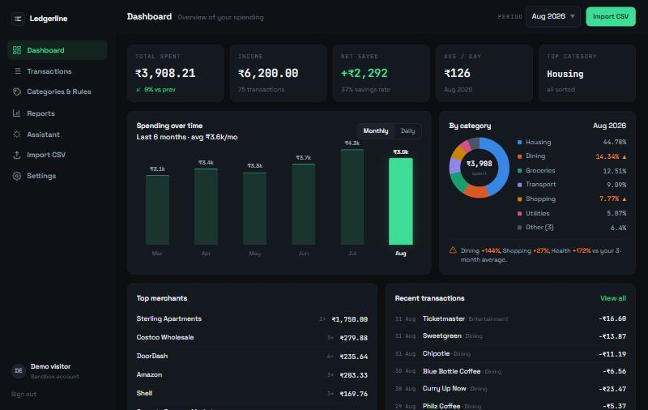
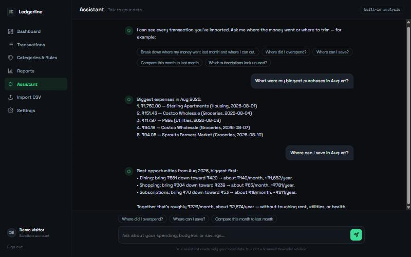
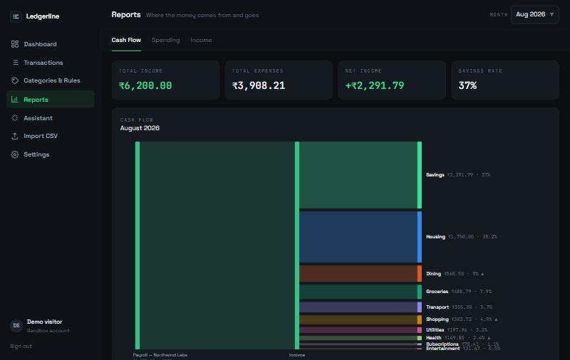
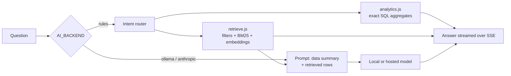

# Ledgerline

A local-first personal finance tracker with an assistant you can ask where your money went.
Import a bank or card CSV, get every transaction auto-categorized, explore the dashboard and
reports, and chat with an assistant whose answers are **measured against a hand-labelled eval**.

<!-- Live demo: add your Render URL here after deploying (see DEPLOY.md) -->



| Assistant | Cash flow report |
|---|---|
|  |  |

## Why it's interesting

- **A retrieval pipeline that's evaluated, not assumed.** The assistant retrieves transactions with
  structured filters, BM25-style lexical scoring and optional embeddings. A 50-question eval with
  hand-labelled gold answers compares keyword, semantic and blended retrieval, and drove every
  tuning decision. [Results below.](#how-well-does-retrieval-work)
- **Works with no AI model at all.** The default assistant is deterministic code over your own
  data: instant, offline, exact. Ollama (local) or Claude can be switched on for more natural
  answers.
- **Local-first.** SQLite in a single file, no accounts with third parties, no chart library, no
  build step. Import a statement and nothing leaves the machine.
- **Honest about its limits.** See [Known limitations](#known-limitations).

## Features

- **Dashboard**: KPI cards, spending over time (last 6 months, daily, or a full-year view with
  one bar per month), category breakdown with spike warnings, top merchants, recent transactions.
- **Transactions**: filter by month / category / type, fix a category inline (which teaches the
  classifier), add or delete entries.
- **Categories & Rules**: your own keyword rules, then keyword defaults, then an on-device Naive
  Bayes classifier that learns from every correction. An "Uncategorized" queue to triage.
- **Reports**: a cash-flow Sankey (income → categories → savings), plus spending and income tabs.
- **Assistant**: "biggest purchases in August", "where can I save?", "compare to last month",
  "which subscriptions look unused?", "show me my Shell charges". Answers stream as they're written.
- **Import CSV**: drag a file in, confirm the detected column mapping, preview, import. Duplicate
  rows are skipped, so re-importing a statement is safe.
- **Works on phones.** Below 900px the sidebar becomes a top bar with a menu, transaction rows
  become cards, and the cash-flow Sankey turns into a bar list. No separate mobile app or build.
- **One-click demo mode** for public deployments: each visitor gets a private sandbox account
  with sample data.

## Quick start

Needs **Node.js 22.5+** (uses the built-in `node:sqlite`; the npm scripts pass the flag).

```bash
npm install
cp .env.example .env      # optional: every setting has a default
npm run seed              # a demo account with ~270 transactions (May to Sep 2026)
npm start                 # http://localhost:3000
```

Sign in with **demo@example.com** / **demo1234**, or create an account to start empty.

| command | what it does |
|---|---|
| `npm start` | run the server |
| `npm run dev` | run with `--watch` |
| `npm run seed` | regenerate the demo user's data |
| `npm run reset` | wipe **all** data, then regenerate the demo user |
| `npm test` | 54 unit tests (retrieval, assistant routing, demo sandbox, eval scoring) |

Sample files for the importer are in `public/assets/`:

| file | shape |
|---|---|
| `sample-bank-export.csv` | `Posting Date, Description, Amount` (signed), about a month |
| `sample-card-export.csv` | `Transaction Date, Description, Category, Debit, Credit`, about a month |
| `sample-household-inr.csv` | `Date, Description, Category, Type, Amount`: **2,125 real INR transactions, 2015 to 2018**, derived from the public *Daily Household Transactions* dataset (Kaggle `prasad22`) and remapped to Ledgerline's categories. Set `CURRENCY=₹`. |

## How the assistant works



`AI_BACKEND` in `.env` picks the engine:

| value | needs | notes |
|---|---|---|
| `rules` *(default)* | nothing | Deterministic intent router over `analytics.js` and `retrieve.js`. Always works, offline. |
| `ollama` | [Ollama](https://ollama.com) running locally | `ollama pull llama3.2:3b` (any chat model). Free, private. |
| `anthropic` | `ANTHROPIC_API_KEY` | Claude via the official SDK. A summary of your monthly totals is sent to the API per question. |

If the chosen backend is unavailable, the assistant falls back to `rules` and says so.

### Retrieval

Every question also goes through `src/retrieve.js`:

1. Parse **structured filters** from the text: amounts ("over 100", "between 40 and 60"), months and
   years, categories, income vs expense.
2. Narrow the transactions with those filters, then rank the rest with a **BM25-style lexical
   score** over date, merchant, category and note.
3. Optionally blend in **embedding similarity** (Ollama `nomic-embed-text`) so "eating out" finds
   Chipotle and "AMZN" finds Amazon. `RAG_SEMANTIC_WEIGHT` (default 1) and `RAG_SEMANTIC_MIN`
   (default 0.6) were tuned on the eval's tuning split with `eval/tune.js`.
4. The top rows go into the LLM prompt (LLM backends) or straight into the answer (`rules`).

Totals are always computed in SQL over the full match set, never summed from the rows shown.

### How well does retrieval work?

`eval/` holds a **50-question eval**: 26 questions on the seeded demo account and 24 on the
household dataset (2,121 transactions after import de-duplication), hand-labelled with gold
transaction ids and expected answers. The
35 / 15 tune / test split was fixed before any retrieval number existed; tuning used the tune
split only. Format and scoring definitions are in [`eval/FORMAT.md`](eval/FORMAT.md).

Retrieval **recall@20** and **answers correct**, first run versus the current code:

| approach | recall@20, tune (35) | recall@20, test (15) | answers correct, tune | answers correct, test |
|---|---|---|---|---|
| keyword only | 0.46 → 0.60 | 0.49 → 0.60 | 8 → 10 | 6 → 7 |
| semantic only | 0.77 → 0.76 | 0.81 → 0.93 | 5 → 9 | 5 → 8 |
| blended | 0.71 → 0.79 | 0.81 → 0.93 | 5 → 8 | 5 → 7 |
| **app default** | **0.71 → 0.82** | **0.75 → 0.93** | **5 → 10** | **5 → 7** |

What produced the gains: tuning the blend weight and cut-off, and fixing concrete failures the
eval exposed (month and year parsing, currency and punctuation handling, amount windows, answer
routing, merchant matching). Full per-question results for every run are in `eval/results/`.

Read these numbers carefully:

- Absolute answer accuracy is still modest (10 of 35 and 7 of 15). Open-ended questions such as
  "what did I spend on street food and sweets?" need a looser notion of "topic" than the rules
  assistant has, so it now says it can't give a reliable total instead of guessing.
- The test split was scored on every run, not once, so treat it as a validation set rather than a
  pristine holdout. 15 questions is also a small sample.
- Run it yourself (the scripts refuse the live database; they work on a snapshot copy):
  `node --experimental-sqlite eval/make-snapshot.js --embed` then `eval/run-eval.js --label mine`.

## Demo mode (public showcase)

Set `DEMO_MODE=true` and the login page shows **Explore with sample data**. Each click creates a
private sandbox account with the sample dataset, so visitors never see or change each other's
data. Sandboxes:

- have no usable password (nobody can sign in to one again) and are deleted after
  `DEMO_TTL_HOURS` (default 24);
- are capped at `DEMO_MAX_ACTIVE` (default 100) and rate-limited to 5 per hour per IP;
- always use the built-in assistant, so anonymous visitors can't run up a hosted or local model.

## Data & privacy

- Everything is stored in `data/finance.db` (SQLite, git-ignored); set `DATA_DIR` to move it.
- Passwords are hashed with bcrypt. The session is a signed cookie; if `SESSION_SECRET` is unset
  the app generates one and keeps it next to the database.
- With `AI_BACKEND=rules` or `ollama`, no transaction data leaves the machine. With `anthropic`, a
  summary of monthly totals and the category breakdown is sent to the Claude API for each question.

## Deploying

See [DEPLOY.md](DEPLOY.md). Short version: a host with a persistent disk (a Render Blueprint is in
`render.yaml`), `NODE_ENV=production`, `DATA_DIR` on the disk, `AI_BACKEND=rules`. Serverless
hosts such as Vercel don't fit: the filesystem is temporary and the app is a long-running server
with a local database.

## Known limitations

- **LLM backends can misquote numbers.** They are handed a text summary and do their own
  arithmetic; in a spot check a local model labelled net savings as the Housing total. The
  `rules` backend can't make that mistake. The redesign in [ASSISTANT.md](ASSISTANT.md) moves every
  figure into tool calls computed by code, and adds charts in the chat and a finance-guide
  knowledge base. It is a proposal, not built yet.
- No email verification or password reset.
- The sidebar's **Settings** item is a placeholder.
- Bank aggregation (Plaid, Teller, GoCardless) is intentionally not built; the `source` column
  and CSV pipeline leave room for a connector.
- `node:sqlite` prints an `ExperimentalWarning` on startup. It is harmless.

## Project layout

```
server.js              Express app: sessions, static assets, route mounting, auth guard
src/
  paths.js             DATA_DIR and default file locations
  db.js                SQLite schema + connection
  auth.js              signup / login + requireAuth middleware
  demo.js              one-click sandbox accounts (DEMO_MODE)
  seed.js              deterministic demo dataset
  csv.js               CSV parse, column detection, row normalization
  categorize.js        user rules + keyword defaults + Naive Bayes classifier
  analytics.js         every spending aggregation (months and years; used by API and assistant)
  retrieve.js          retriever: structured filters + BM25-style score + hybrid semantic rank
  embed.js             Ollama embeddings: index, store, cosine
  vocab.js             shared vocabulary (synonyms, months, stopwords, tokenizer)
  agent.js             assistant: rules / ollama / anthropic backends, SSE streaming
  routes/              auth, transactions (+ import), rules, analytics, embed, chat
public/
  *.html               pages: login, signup, dashboard, transactions, rules, reports, assistant, import
  assets/              styles.css, shell.js, per-page scripts, favicon, sample CSVs
eval/                  retrieval eval harness, questions, results (see eval/FORMAT.md)
test/                  unit tests
docs/screenshots/      README images
```
